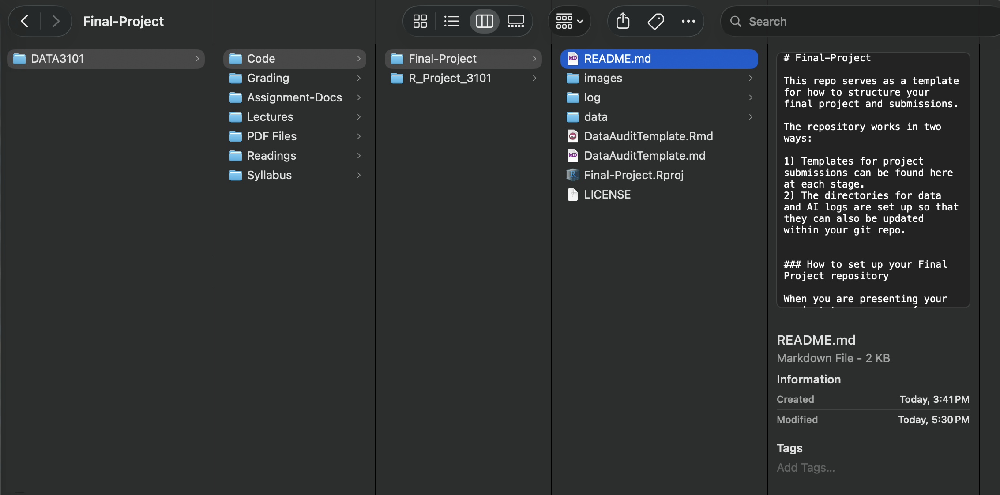

# Final-Project

This repo serves as a template for how to structure your final project and submissions. 

### Reducing git commit confusion

Here's a couple tips for how to not confuse future commits between assignments, live coding sessions, and your final project:

- When you clone your new repo to your computer, DO NOT save it within the `.RProj` folder you are using for your class repo.
- Instead, clone it to the parent directory above the repo. Here's a picture to show what I've done in my example.

The image above shows how I've organized my files in the folder I use to keep track of all things DATA3101.

- The DATA3101 folder on the left keeps me organized with the class I'm teaching
- Inside, you can see the admin folder I've been using to keep track of things in the class
  - For example: my Assignment-Docs folder is connected to the Assignment-Docs you've referenced before for previous assignments in our GitHub organization!
  - The actual scripts and other things I do in this class have been saved in the `Code` subfolder instead
- In `Code/` you can see where I've created two coding repositories. 
    - `R_Project_3101` is what I used to test initial cloning or forking problems people may have had in Assignments 1 & 3. I also save my live coding things in there, but keep this repo local so that I don't confuse course development with what we do together
    - `Final-Project` is the folder that I used to create the repo template for **your** final projects!
    - Each of the two subfolders within `Code` (`R_Project_3101` and `Final-Project`) were initially cloned from GitHub. 

You don't have to organize your course documents in exactly the same way I have been, if you have your own system that's fine! Here is how you can reduce confusion though for future coding sessions and project development.

1. Once you've cloned your new Final Project repository to your computer, open a new RStudio session
2. Select `File > New Project`
3. Click `Use Existing Directory` in the New Project window

You now have a new RProject that should work the same as your existing Project.

#### Housekeeping Tips

Whenever you are starting a new coding session, make sure you have opened the RProject you intend to work on. For instance, don't expect your live coding to update and commit cleanly in your original class repository if you were updating it in your Final Project repository!

Always save your file, and commit it when you are ending a coding or writing session.

Push your commits often! If you make mistakes (we're all human, it happens), this means you can see exactly where you may have accidently saved a file in the wrong folder.

----- [Sources] -----

I received my data sources from openpowerlifting.org, it is a free open-sourced data deposit that is consistently updated.

----- [Information] -----

This project aims to graph and analyze powerlifting competition data. openpowerlifting.org will be used to interpret strongest countries, bodymass - strength comparisons, and percentages of tested and untested athlets.

